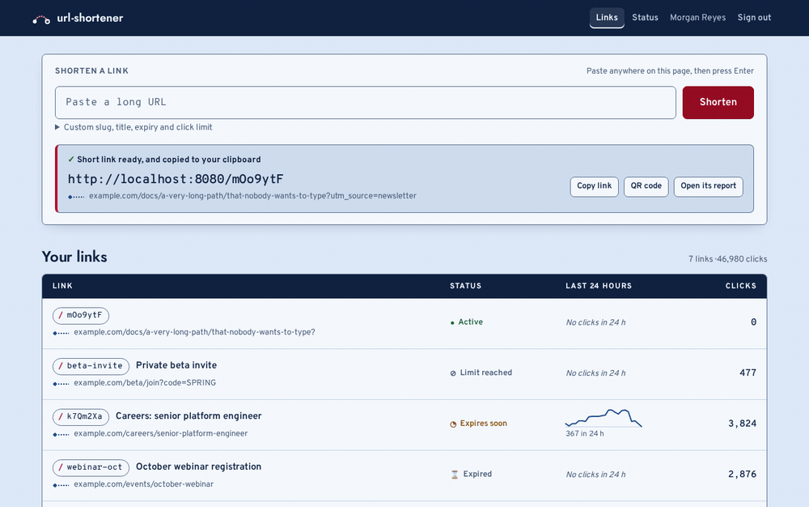
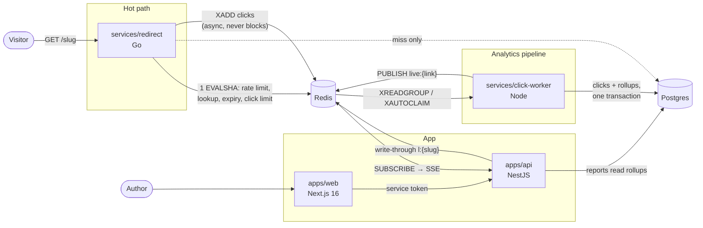

# url-shortener: sub-millisecond redirects, and every click accounted for

[](https://github.com/bastian-red/url-shortener/actions/workflows/ci.yml)

Shorten a link, share it, watch every click arrive live: country, device, browser, referrer. The
redirect path is a Go service that answers from one Redis round trip and never touches the
analytics. Clicks travel through a Redis Stream to a Node worker that enriches them, stores them
exactly once and keeps hourly rollups current, so a report over a million clicks reads 52,172 rows
(measured), not a million. QR codes, custom slugs, expiry, click limits, rate limiting. Next.js 16,
NestJS, Go, PostgreSQL, Redis.





## The hard part: a redirect that analytics cannot slow down

A shortener's redirect is the one request users notice, and the obvious design puts the analytics
right in it: look up the link, insert a click row, redirect. Then the redirect is as fast as the
slowest insert, and a slow database turns into slow links.

Here the two paths share nothing but a Redis Stream.

**The redirect** (`services/redirect`, Go) runs **one Lua script per request**. The script checks
the client's rate limit (GCRA, one key per address), reads the cached link, checks its expiry and
its click limit, increments the counter, and returns the target. Redis runs the script without
interleaving anything, so two visitors cannot both take the last click of a 100-click link. A
cache hit costs no SQL at all. On a miss, `singleflight` collapses a burst for one slug into a
single Postgres query, and unknown slugs are cached as unknown for a minute, so a scanner cycling
random slugs cannot hammer the database.

The click goes onto a bounded in-memory queue, and the handler returns. Goroutines drain the queue
into pipelined `XADD`s. If Redis is slow, the queue fills and events are **dropped and counted**
(`clicks_dropped_total`). The visitor is never delayed. A lost click is a reporting error; a slow
redirect is a product failure.

The redirect answers `302`, not `301`. Browsers cache a 301 forever by default, so every later
visit would skip the service: the click would go uncounted, and an edit or a disable would never
reach anyone who had visited once.

**The worker** (`services/click-worker`) reads the stream as a consumer group, enriches each click,
and writes the raw row plus both rollup tables **in one transaction**. Enrichment is a local geo
lookup, the user agent, a bot check, the referrer host and a salted visitor hash. Its insert is
`ON CONFLICT DO NOTHING` on the stream entry id, and only the rows that actually went in are rolled
up. It acknowledges an entry only after the commit. A worker that dies at any point leaves its
entries pending, another consumer reclaims them with `XAUTOCLAIM`, and replaying a committed batch
adds nothing.

### Measured

`./scripts/loadtest.sh`, on a laptop with Postgres, Redis, the worker and the load generator all on
the same machine. vegeta sends 500 requests/s for 10 s, spread over 4,000 client addresses at the
**documented** rate limit:

| Phase | Requests | p50 | p95 | p99 |
|---|---|---|---|---|
| Worker consuming the stream | 5,000 | 0.72 ms | 1.34 ms | 2.35–2.54 ms |
| Worker SIGKILLed mid-run (stream backing up) | 5,000 | 0.59 ms | 1.00 ms | 1.66–1.78 ms |

Three runs. After the worker restarts, all **12,001 of 12,001** requests (warm-up included) are rows
in Postgres, and `clicks_dropped_total` is 0. The budgets are p50 1.5 ms and p99 5 ms locally, and
p99 25 ms on CI's shared runners. A 3 ms sleep added to the handler fails the lane (p50 4.29 ms). The
p99 is *higher* while the worker is consuming, not lower: here it shares the CPU with Postgres. The
redirect code doesn't change between the two phases, and separate machines would close that gap.

## What it has to get right, and the test that holds each

| Claim | Held by |
|---|---|
| A cache-hit redirect is sub-millisecond at p50, single-digit ms at p99 | `scripts/loadtest.sh` → `services/redirect/loadtest` (vegeta) |
| Analytics cannot slow the redirect | same lane: the worker is killed between phases and p99 must stay within max(1 ms, 25%) |
| Every click is counted exactly once, even when the worker dies | `services/click-worker/test/crash.test.ts`: commit-then-crash-before-`XACK` (deterministic), and a real `SIGKILL` at ~40% of 2,000 events, then exactly 2,000 rows |
| A 100-click link grants exactly 100 redirects | `linkcache_test.go`: 200 concurrent requests on a 50-click link, exactly 50 granted |
| An edit, disable, expiry or delete is live on the very next request | `apps/api/test/links.test.ts` against the running Go service: write-through inside the row lock, and set-if-absent on the miss path so a stale read can never overwrite it |
| A report over 1,000,000 clicks stays under 150 ms at p95 | `apps/api/test/scale.test.ts`: measured **p95 86–101 ms** (p50 67–87 ms) across runs, uncached, 40 reports per run |
| The rollups always equal a recount of the raw log | `ROLLUP_DRIFT_SQL` after the crash test, the scale test, the seed and the whole integration lane; a property test over random batch splits (`aggregate.test.ts`) |
| A visitor's IP address is never stored | `pipeline.test.ts` searches every table as text for the address, and checks that the stream entry is deleted after processing (not just acknowledged); the schema test refuses any `ip`/`address` column |
| A click reaches the open dashboard within 2 s | `pipeline.test.ts` (measured ~60 ms), `links.spec.ts` in Chromium and Firefox |
| Rate limits apply where they are meant to | 6th sign-in → 429, and it does **not** limit the link list or `/health`; 31st link in a minute → 429; the redirect's GCRA burst then `Retry-After` |
| A printed QR code survives an edit | the QR encodes the short URL, decoded and asserted with jsQR (`links.test.ts`, `links.spec.ts`) |
| A deleted slug can never be claimed by somebody else | soft delete keeps the slug unique; re-creating it answers 409 |
| `pnpm dev` works from a fresh clone | `scripts/dev-smoke.sh`, with every `.env` name stripped, all four processes, and one visit followed to Postgres |

## Privacy

The IP address goes into the click event and comes out of the worker as two things only: a country
from a local database (no third party sees it) and a **visitor hash**. The hash is
`HMAC-SHA256(daily key, ip | user agent)` truncated to 16 bytes, with the daily key derived from a
secret and the click's UTC date. It counts distinct visitors per hour. It cannot follow a person
across days, and without the secret nobody can reverse it by enumerating IPv4. No table has an
address column, and a processed stream entry is `XDEL`ed, not only acknowledged, so the address
does not linger in Redis' append-only file either.

## Reports from rollups

Each batch upserts `link_hours` (clicks, bots and distinct visitors per link per hour) and
`click_rollups` (one row per link, hour, bot flag, dimension and value) in the same transaction as
the raw rows. It is one row per *dimension*, not per combination: the cross product of country ×
device × browser × OS × referrer would be close to one row per click, which is not a rollup. A
month of a million clicks is 720 link-hours and 51,452 rollup rows to aggregate (counted by the
scale test).

Hour buckets are cut in UTC and day buckets in the viewer's zone. A local *hour* is ambiguous twice
a year: the repeated 01:00 would merge two hours, and the skipped 02:00 would invent one. A UTC
*day* would put a Santiago author's evening on tomorrow. Upserts list their rows sorted by primary
key, so two workers always take row locks in the same order and cannot deadlock.

Raw clicks are range-partitioned by month (`ensure_click_partitions`, called by the worker daily,
advisory-locked against concurrent callers), with a default partition so an insert is never
refused.

## The design: the route map

A shortener's user pastes a URL, shares the short one, and days later asks where it travelled. The
visual world is the mid-century airline route map: a sky-chart ground, navy map ink, one route
red, a navy band across the top. It lends the type, the palette, the density and one signature
move; the layout and the controls stay the standard ones a link tool's users already know.

- **Create and copy in one paste.** Paste a URL anywhere on the page (focus does not have to be in
  the field) and it is shortened, and the short link is already on your clipboard. The result
  strip says so in words, and keeps a Copy button for when the browser refuses the write.
  `e2e/tests/links.spec.ts` counts the actions (one) and reads the clipboard back.
- **The ledger is a timetable.** Slug, title, the destination drawn as a route, status as a glyph
  and a word, the last 24 hours, the count that ticks "+1" as clicks land. A link with no clicks
  in a day says *No clicks in 24 h* instead of drawing a flat line that looks like a quiet live one.
- **The report.** One **timeline you brush** (drag, or the arrow keys with Shift) re-scopes every
  number below it to exactly those hours. The totals say what they count: a visitor is someone
  clicking, counted once per hour. Then the signature, **Where it travelled**: referrers fly in
  on the left, countries fly out on the right, the short link is the hub, and each leg is weighted
  by its share of its own side. The rollups hold one dimension at a time, so the board never draws
  a referrer straight to a country, which would invent a joint distribution the data does not
  have (`apps/web/lib/route.ts`). The lists are real text; the drawing is decoration over them and
  is dropped on a phone for the lists' own bars. Beside it, a **tape** lists clicks as they arrive.

Headings and figures are set in Jost, a geometric sans in the line of timetable and route-map
type; the interface in Overpass, derived from the US road-sign face; anything you might retype in
Overpass Mono, where `l`, `I` and `1` cannot be confused (slugs are case-sensitive). All three are
self-hosted with their SIL licence. Every colour pair clears WCAG AA in both schemes, checked
against the real stylesheet, and the palette is at least ΔE 2.5 (canvas) and 8 (accent) from every
other project in the portfolio. Every status has a glyph and a word as well as a colour, every
chart has its numbers as a table, no route scrolls sideways at 390 px, and axe runs over every
route in both schemes, including the Go service's own 404/410 pages, with zero violations. Those
pages carry real status codes, so a crawler can tell a slug that never existed from one that
expired.

## Running it

Requirements: Node 20, pnpm 9, Go 1.27, Docker.

```bash
git clone https://github.com/bastian-red/url-shortener.git
cd url-shortener
pnpm install

cp .env.example .env
sed -i "s|^AUTH_SECRET=|AUTH_SECRET=$(openssl rand -base64 32)|" .env
sed -i "s|^VISITOR_HASH_SECRET=|VISITOR_HASH_SECRET=$(openssl rand -base64 32)|" .env

docker compose -f infra/docker-compose.yml up -d   # Postgres :5442, Redis :6388
pnpm geo:download                                  # DB-IP City Lite, once (~60 MB)
pnpm db:deploy
pnpm db:seed                                       # six links, 49,000 clicks over 30 days

pnpm dev    # web :3000, api :4000, redirect :8080, worker :4100
```

Open http://localhost:3000 and sign in as `demo@links.test` / `demo-password-2026`. Open
http://localhost:8080/launch in another tab and watch the click land on *Spring launch post*.
http://localhost:8080/old-promo is a turned-off link and answers the Go service's own `410` page.

The whole stack in containers, migrated and seeded:

```bash
docker compose -f infra/docker-compose.yml --profile app up -d --build
```

`pnpm dev` goes through `scripts/dev.sh`. It loads `.env`, checks both secrets and Go, fetches the
geo database if it is missing, checks that Postgres and Redis answer, and then starts turbo. Turbo
runs in strict environment mode and reads no `.env` on its own, so `turbo run dev` alone would
start four processes with no configuration.

## Testing

| Lane | Command | What it needs |
|---|---|---|
| Gate (pre-commit) | `pnpm test` + `go test ./internal/...` | nothing; seconds |
| Environment contract | `pnpm env:contract` | nothing (scans TypeScript **and** Go) |
| Integration | `./scripts/integration.sh` | Postgres, Redis; three processes, the crash test, the 1M-click report |
| Latency | `./scripts/loadtest.sh` | Postgres, Redis, Go |
| Database drift | `pnpm db:drift` | a migrated database |
| Seed determinism | `pnpm db:seed:check` | a database |
| Rollup recount | `pnpm db:recount` | a database |
| Dev smoke | `./scripts/dev-smoke.sh` | datastores up; runs the documented `pnpm dev` |
| E2E + accessibility | `./scripts/e2e.sh` | datastores up; Chromium and Firefox |
| Demo GIF | `./scripts/demo-gif.sh` | ffmpeg, ImageMagick |

The integration and latency lanes use their own database (`links_it`) and Redis database indexes,
so they never touch the data `pnpm dev` is using. Both run at the **documented** budgets, spreading
traffic over addresses and users the way real traffic is keyed. A lane that lifts a limit hides
that limit's bugs.

Every claim in the table above has been proven able to fail: the fix was reverted, the test went
red, and the fix was restored. That covers the idempotent insert, the `XDEL`, the write-through,
the click-limit check and the latency budget.

The pre-commit hook runs gitleaks, the environment contract, the invisible-character scan, the gate
lane, `gofmt` and `go vet`. CI runs every lane on every push and builds all four Docker images.

## Cross-language contracts

The Go service and the TypeScript side cannot import each other's types, so the shapes they share
(the click event, the cached link record, the health report) are JSON Schemas in
[`contracts/`](contracts/), each with a golden fixture. Both sides test against the same files:
the Go encoder must reproduce the fixture byte for byte, and the zod schemas and JSON Schemas must
name the same fields. Rename a field on either side and one half goes red.

## Configuration

Every variable is documented in [`.env.example`](.env.example) and declared in `turbo.json`.
`scripts/env-contract.mjs` fails the commit when the source (including the Go service's
`os.Getenv` reads), `.env.example` and `turbo.json` disagree.

IP geolocation by [DB-IP](https://db-ip.com) (City Lite, CC BY 4.0). The integration and E2E
lanes use MaxMind's published test database instead, so their assertions do not move monthly.

## Layout

```
services/redirect      Go: GET /{slug}, the Lua hot path, the click emitter, /health, /metrics
services/click-worker  Node: stream consumer, enrichment, exactly-once writer, rollups, live publish
services/link-rules    slug generation (CSPRNG, unbiased base62), reserved words, destination rules
apps/api               NestJS: auth, links, QR, analytics, SSE live feeds, /health, /status
apps/web               Next.js: command bar, ledger, link report with brush, live tape, /status
packages/db            Prisma schema, partitioned clicks migration, seed, recount
packages/shared        zod contracts, link status, errors
contracts              JSON Schemas + golden fixtures shared by Go and TypeScript
e2e                    Playwright
infra                  Dockerfiles (distroless Go image) and docker-compose.yml
```
